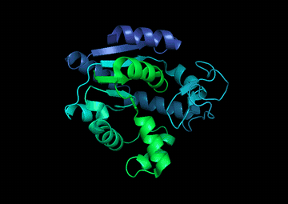
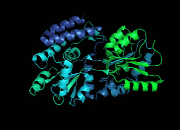
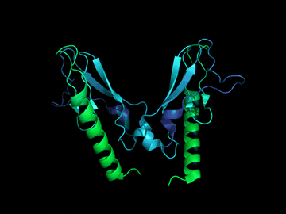
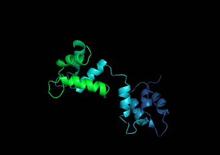

# 3D Protein Simulator

**Pseudo-molecular dynamics from experimentally solved protein structures.**

`MDsimulator.py` takes a PDB identifier, finds other experimental structures
of the same protein, superimposes them and turns them into an animated GIF in
which the protein appears to move between its conformations. It is not a
physics-based molecular dynamics engine: every frame comes either from a real
deposited structure or from a linear interpolation between two of them. The
result is a fast, visual way to see the conformational changes that the
Protein Data Bank already records, such as domain closure, hinge motions or
the rearrangement that follows ligand or calcium binding.

📖 **Project website:** <https://dongazpachowr.github.io/3D_protein_simulator/>

<p align="center">
  
  
</p>
<p align="center">
  <em>Left: adenylate kinase (4AKE family) closing its LID and NMP domains.
  Right: hinge-twist of the maltodextrin-binding protein (1OMP family).
  Both made in structural-alignment mode.</em>
</p>

## Contents

- [How it works](#how-it-works)
- [Installation](#installation)
- [Usage](#usage)
- [Command-line reference](#command-line-reference)
- [Output files](#output-files)
- [Examples](#examples)
- [Limitations and tips](#limitations-and-tips)
- [Repository layout](#repository-layout)

## How it works

The pipeline has five stages. Each stage can be skipped by supplying its
result directly, which makes it easy to iterate on a difficult protein
without repeating the slow network steps.

1. **Sequence retrieval.** With `-id`, the script queries NCBI Entrez
   (protein database, `pdb[filter]`) for the given PDB code and downloads the
   FASTA sequence of the first matching record.
2. **Search for related structures.** The sequence is sent to NCBI BLASTp
   against the `pdb` database with an E-value cutoff of 0.05, a minimum
   identity of 99 % and `--hits` results (5 by default). The raw BLAST XML is
   saved as `alignment.txt`, and the unique four-letter PDB codes of the hits
   become the set of structures to animate. The near-identity threshold keeps
   only structures of the same protein, so the differences between them are
   conformational rather than evolutionary. You can skip this stage by
   passing a saved BLAST XML (`-al`) or a hand-curated list of PDB codes
   (`-l`).
3. **Download.** Every structure is downloaded in mmCIF format with
   Biopython's `PDBList` into `<output_dir>/pdbs/`. Files that are already
   there are not downloaded again.
4. **Filtering and chain mapping.** Structures whose atom count falls
   outside 0.5–2× that of the reference structure are discarded; this
   removes fragments and large complexes that would break the superposition.
   The reference is the first file, which is the first entry of the list
   when `-l` is used. The kept files are written to `filtered_pdb.txt`.
   Because many entries label their chains inconsistently, each requested
   chain is translated from the mmCIF `label_asym_id` to the author
   `auth_asym_id` before it is passed to PyMOL.
5. **PyMOL script and rendering.** The script writes a PyMOL `.pml` file
   that loads each structure, extracts the requested chains, fits every
   structure onto the first one, stacks them as states of a single object,
   colours the cartoon and exports the movie with `movie.produce`. The two
   methods differ in how they fit and animate the states:

| | `superposition` (default) | `structural_alignment` |
|---|---|---|
| Atoms used | All polymer atoms of the chain | Backbone only (`CA`, `C`, `N`, `O`) |
| Fitting | PyMOL `super` (sequence-independent) | PyMOL `align` (sequence alignment, then fit) |
| Animation | Each structure held for 10 frames, then the next one | `morph` with linear interpolation, 30 frames between consecutive structures |
| Look | Step-wise jumps between real conformations | Smooth, continuous motion |
| Rendering | Runs automatically in headless PyMOL | You run the generated `.pml` yourself |
| Requirements | Open-source PyMOL | PyMOL build that includes `morph` (Incentive PyMOL licence) |

In both modes alternate location B is removed (`not alt B`), so each
residue keeps a single conformer, and `cif_use_auth` is enabled so that
chain selections match the author annotation.

## Installation

The tool runs on Linux with conda. The provided `environment.yml` is a full
export of the environment used during development (Python 3.12,
Biopython, open-source PyMOL and their dependencies).

```bash
git clone https://github.com/DonGazpachoWR/3D_protein_simulator.git
cd 3D_protein_simulator
conda env create -f environment.yml
conda activate estructural

# PyMOL needs ffmpeg to encode the GIF
sudo apt install ffmpeg -y
```

If the exported environment does not resolve on your system, a minimal
environment works as well:

```bash
conda create -n estructural -c conda-forge python=3.12 biopython pymol-open-source
```

The BLAST and Entrez steps need an internet connection. NCBI asks every
client to identify itself with an e-mail address; the script sets one in
`get_sequence()` and `get_pdb_variants()`, so replace it with your own if
you reuse the code.

## Usage

At least one input is required: a PDB code (`-id`), a saved BLAST result
(`-al`) or a list of PDB codes (`-l`). If several are given, `-l` takes
precedence over `-al`, and `-al` over `-id`.

**From a PDB code (full pipeline).** Runs Entrez, BLAST, the download and
PyMOL, and leaves `animated.gif` in the output directory.

```bash
python MDsimulator.py -id 5OTX -o results/5otx
```

**Reusing a BLAST result.** Skips the slow BLAST step.

```bash
python MDsimulator.py -al results/5otx/alignment.txt -o results/5otx
```

**From a curated list.** Best when BLAST returns fragments, mutants or
complexes that spoil the animation. Write one PDB code per line (lines
starting with `#` are ignored); the order of the file is the order of the
animation, and the first code is the reference.

```bash
python MDsimulator.py -l examples/4AKE/curated.txt -o results/4ake -c A
```

**Smooth morph (structural alignment).** The script only writes the PyMOL
file; run it afterwards with a PyMOL that supports `morph`.

```bash
python MDsimulator.py -l examples/4AKE/curated.txt -o results/4ake \
    -m structural_alignment
pymol results/4ake/molecular_dynamics_morph.pml
```

**Several chains.** Separate chain IDs with commas or `+`.

```bash
python MDsimulator.py -id 3QGK -o results/3qgk -ht 30 -c A,B,C -col green
```

## Command-line reference

| Option | Default | Description |
|---|---|---|
| `-id`, `--id_pdb` | – | PDB code of the query protein. Triggers the Entrez + BLAST search. |
| `-al`, `--alignment` | – | BLAST XML saved by a previous run (`alignment.txt`). Results are reliable with 99 % identity and about 5 hits. |
| `-l`, `--list` | – | Text file with one PDB code per line. Sets the order of the animation and the reference structure. |
| `-o`, `--output_dir` | `.` | Output directory; created if missing. |
| `-ht`, `--hits` | `5` | Maximum number of BLAST hits. |
| `-m`, `--method` | `superposition` | `superposition` (more robust) or `structural_alignment` (smoother, interpolated). |
| `-c`, `--chains` | `A` | Chains to animate, e.g. `A`, `A,B` or `A+B`. |
| `-col`, `--color` | `2` | `1`: green→cyan→blue gradient along atom order; `2`: the same gradient by residue number; any other value is used as a PyMOL colour name (e.g. `green`, `deepblue`). |

## Output files

All files are written to the output directory.

| File | Created by | Content |
|---|---|---|
| `alignment.txt` | `-id` | BLAST XML of the sequence search. |
| `pdbs/*.cif` | all runs | Downloaded mmCIF structures. |
| `filtered_pdb.txt` | all runs | Structures that passed the atom-count filter, in animation order. |
| `molecular_dynamics_superposition.pml` | `superposition` | PyMOL script that builds and exports the animation. |
| `molecular_dynamics_morph.pml` | `structural_alignment` | PyMOL script with the morph; run it manually. |
| `pymol_process.log` | `superposition` | Output of the headless PyMOL run, useful when rendering fails. |
| `animated.gif` | PyMOL | The final animation. |

## Examples

The `examples/` folder holds the inputs used for the animations shown on
the website: the curated lists (`curated.txt`), the BLAST results where the
automatic search was used (`alignment.txt`) and the structures that passed
the filter (`filtered_pdb.txt`). The mmCIF files are not included because
the script downloads them again. To reproduce an example, point `-l` at its
list and choose an empty output directory.

| Folder | Protein | Chains | Structures in the animation |
|---|---|---|---|
| `5otx` | GLP-1 receptor extracellular domain bound to GLP-1 variants | A; A,C | BLAST hits for the monomer (4ZGM, 5OTX, 5OTW, 3IOL, 5OTU, 5OTV); 5OTU–5OTX for the dimer |
| `3QGK` | Urease (*Helicobacter*, *Bacillus pasteurii*) | A,B,C | 1E9Y, 1S3T |
| `1TN4` | Troponin C, four-calcium form | A | 2TN4, 1TN4 |
| `1EEA` | Acetylcholinesterase | A | 11 structures (see `filtered_pdb.txt`) |
| `4AKE` | Adenylate kinase (*E. coli*), open → closed | A | 3HPQ, 4AKE, 1E4Y, 1AKE |
| `1OMP` | Maltodextrin-binding protein, hinge-twist | A | 8 structures (see `filtered_pdb.txt`) |
| `1QX5` | Calmodulin, apo and Ca²⁺/peptide-bound forms | A | 1DMO, 1CLL, 3CLN, 1EXR, 1CKK, 2O60, 2VAY |

The troponin C morph was rendered with RigiMOL interpolation by an earlier
development version; the current script always uses linear interpolation.

<p align="center">
  
  
</p>
<p align="center">
  <em>Left: GLP-1 receptor extracellular domain, chains A and C,
  superposition mode. Right: calmodulin, structural-alignment mode.</em>
</p>

## Limitations and tips

The animation is only as meaningful as the structures behind it. The order
of the frames is the order of the BLAST hits or of your list, not a
physical reaction coordinate, so for a clean motion you should order the
list from one end state to the other (for example apo → ligand-bound).
Linear interpolation moves every atom along a straight line, which can
produce intermediate frames with clashes or stretched bonds; treat them as
an illustration, not as a trajectory.

The atom-count filter uses the first structure as its reference. If that
structure is unusually small or large, most of the others will be
discarded; reorder the list so that a typical structure comes first. The
filter considers every file in `pdbs/`, so when you change the list for an
output directory that already exists, delete the old `.cif` files first or
use a new directory. The script reads the list order from the command line
itself, so pass the list as `-l file` or `--list file` rather than
`--list=file`.

Chain naming is a frequent source of empty or partial animations. The
script maps label chains to author chains, but some entries still name the
same protein chain differently; check `filtered_pdb.txt` and the PyMOL log,
and adjust `-c` or the list when a structure appears empty. Large oligomers
render slowly and produce big GIFs, so start with a single chain.

## Repository layout

```
3D_protein_simulator/
├── MDsimulator.py     # the simulator
├── environment.yml    # conda environment used during development
├── examples/          # inputs for the example animations
├── docs/              # project website (GitHub Pages) and media
└── coursework/        # unrelated exercises from the Master's algorithms course
```

The `coursework/` folder contains earlier exercises from the same Master's
programme (graphs, the Burrows–Wheeler transform, suffix arrays and
pairwise alignment with Needleman–Wunsch, Gotoh and Smith–Waterman) that
were stored in this repository before the simulator was added. They are
independent of the simulator.

## Author

Adrián Berenguer Agustí. Developed as the final project of the structural
bioinformatics module of a Master's programme.
